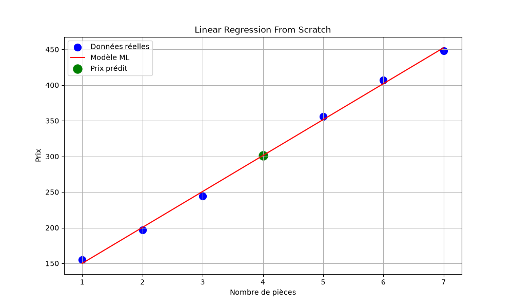
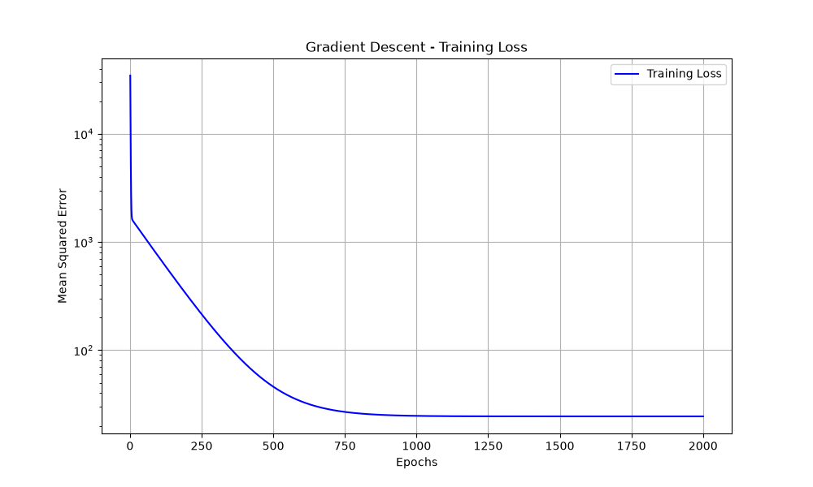

# 🏠 House Price Prediction

An educational end-to-end Machine Learning project using Linear Regression to predict house prices based on the number of rooms.

## Technologies

- Python
- NumPy
- Pandas
- Matplotlib
- Scikit-learn
- Streamlit

## Machine Learning Concepts

- Exploratory Data Analysis
- Linear Regression from scratch
- Ordinary Least Squares
- Gradient Descent
- Mean Squared Error
- Train/Test Split
- Model Evaluation

## Model Performance

| Metric | Value |
|---|---:|
| MAE | 5.6429 |
| MSE | 54.7449 |
| RMSE | 7.3990 |
| R² | 0.8759 |

## Linear Regression



## Gradient Descent



## Installation

```bash
python -m pip install -r requirements.txt
```

## Run the Application

```bash
python -m streamlit run app.py
```

## Example Prediction

The predicted price for a house with four rooms is 301.17.

## Limitations

This educational project uses six observations and one feature. The evaluation metrics are based on only two test observations. It is not intended for real-world property valuation.

## Reference

Inspired by Grokking Machine Learning, Second Edition, by Luis G. Serrano.